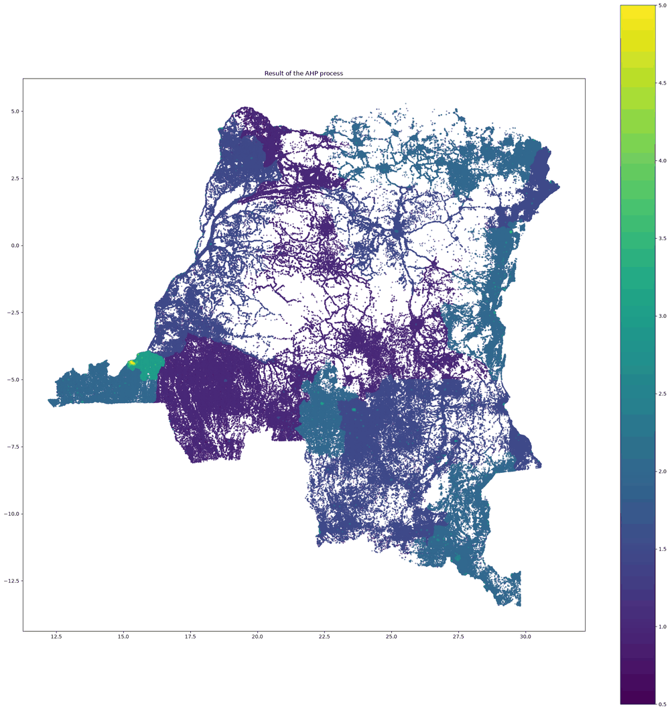
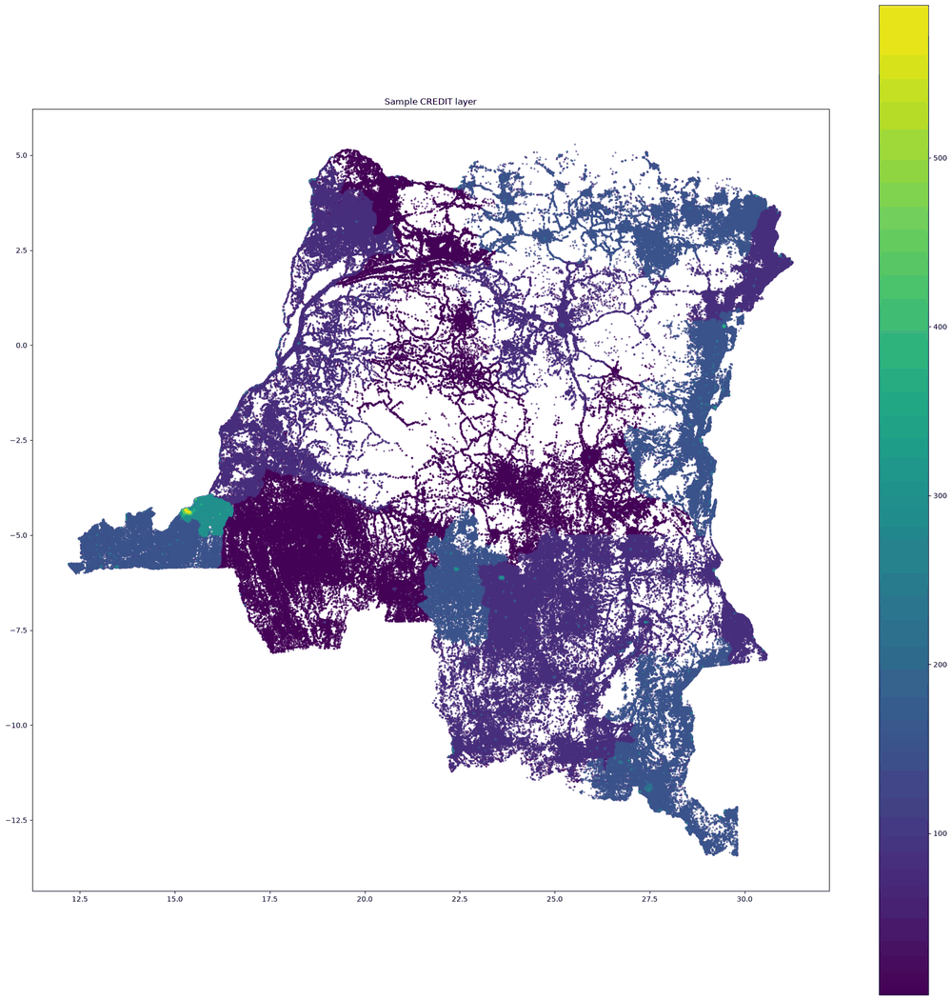

# CREDIT layer — Democratic Republic of the Congo (DRC)

**CREDIT** (Custom Residential Electricity Demand Indicative Target) is a spatially explicit way of assigning residential electricity demand targets to un-electrified settlements. It combines **poverty** and **GDP** maps instead of the usual urban/rural tier split. The method is described in [Korkovelos et al. (2019), *Energies* 12(7):1395](https://www.mdpi.com/1996-1073/12/7/1395).

This repository adapts the [Global Electrification Platform CREDIT_layer](https://github.com/global-electrification-platform/CREDIT_layer) to the **DRC (ISO3: COD)** using 2024 data.

---

## Results

The model produces a ~1 km grid of residential demand targets for the whole country.

| Step 3 — Combined poverty/GDP index (1–5) | Step 4 — CREDIT demand target (kWh/capita/year) |
|:---:|:---:|
|  |  |

- **Highest targets** are around **Kinshasa** (up to ~590 kWh/capita/year, MTF Tier 5).
- **Mid-range targets** (~150–300 kWh/capita/year) appear in Kongo Central, the eastern provinces and the south-eastern mining belt.
- **Lowest targets** (Tier 1–2, below ~150 kWh/capita/year) cover most of the centre and west, where poverty headcounts are highest.

Output files (written to `sample_output/`, not tracked in git):

| File | Description |
|---|---|
| `CREDIT.tif` | Final CREDIT layer, kWh/capita/year, 1 km, EPSG:32734 |
| `AHP_option_1.tif` / `clipped_sum_.tif` | Combined 1–5 index (raster option), clipped to DRC |

---

## How to use this repository

### 1. Clone the repository

```bash
git clone https://github.com/Bachirou06/Credit_DRC.git
cd Credit_DRC
```

### 2. Create the Python environment

With conda (recommended, because GDAL and rasterio install more easily from conda-forge):

```bash
conda env create -f credit_env.yml
conda activate credit_env
```

`requirements.txt` lists the exact package versions the model was run with (Python 3.12). Use it with pip only if GDAL is already installed on your system.

### 3. Run the main notebook

```bash
jupyter lab CREDIT_layer_DRC.ipynb
```

Run the cells from top to bottom. The notebook downloads its own input data the first time:

| Input | Source | Downloaded to |
|---|---|---|
| Poverty (MPI headcount ratio, 26 provinces) | OPHI MPI via [HDX](https://data.humdata.org/) | `poverty_data/tabular/` |
| Province boundaries (ADM1) | [geoBoundaries](https://www.geoboundaries.org/) API | `admin/` |
| GDP PPP 2024, 30 arc-sec (~1.4 GB) | [Kummu et al. v4](https://zenodo.org/records/18429133) | `GDP_data/` |

Files that already exist are not downloaded again. The full run takes a while the first time, mainly because of the GDP download.

### 4. Optional helper notebooks

| Notebook | Use it to |
|---|---|
| `Extraction_GDP_PPP.ipynb` | Download the Kummu v4 raster and extract only the DRC 2024 GDP layer |
| `conversion.ipynb` | Compare the two GDP extraction methods (windowed and general) |

### Repository contents

| File | Purpose |
|---|---|
| `CREDIT_layer_DRC.ipynb` | Main workflow: data → reclassification → index → CREDIT layer |
| `extract_poverty.py` | Downloads the OPHI MPI poverty table and admin boundaries from HDX |
| `extract_gdp.py` | Extracts and clips a country's GDP raster (boundary from geoBoundaries) |
| `preprocess_kummu_gdp.py` | Downloads and pre-processes the Kummu v4 GDP dataset |
| `credit_env.yml`, `requirements.txt` | Python environment |

---

## Method

**Step 1 — Collect data.** Province-level poverty (MPI headcount ratio) is joined to the ADM1 boundaries and rasterised at 1 km. GDP PPP 2024 is clipped to the DRC.

**Step 2 — Reclassify both layers to a 1–5 scale.**

| Poverty headcount | Class | GDP (natural breaks, k = 5) | Class |
|---|:---:|---|:---:|
| < 20 % | 5 | I1 ≤ GDP < I2 | 1 |
| 20–40 % | 4 | I2 ≤ GDP < I3 | 2 |
| 40–60 % | 3 | I3 ≤ GDP < I4 | 3 |
| 60–80 % | 2 | I4 ≤ GDP < I5 | 4 |
| ≥ 80 % | 1 | GDP ≥ I5 | 5 |

The choice of classification method affects the result, so check that it suits your use case.

**Step 3 — Combine the layers** into an index from 1 (low demand) to 5 (high demand):

```
index = 0.5 × poverty_class + 0.5 × GDP_class
```

**Step 4 — Convert the index to a demand target** by linear interpolation between MTF-based minimum and maximum values, scaled for the DRC's average household size.

### DRC-specific settings

| Parameter | Value |
|---|---|
| Country / ISO3 | Democratic Republic of the Congo / COD |
| Poverty data | OPHI MPI headcount ratio, ADM1 (26 provinces; MPI is only published at ADM1) |
| GDP data | Kummu et al. v4, GDP PPP 2024, 30 arc-sec |
| Projection | WGS 84 / UTM zone 34S (EPSG:32734) |
| Weights | poverty 0.5, GDP 0.5 |
| Household size | ~5.3 people |
| Demand range | 7.6 kWh/capita/year (Tier 1) to 590.4 kWh/capita/year (Tier 5) |

---

> **Note.** CREDIT does not *predict* electricity demand; it is not a regression model. It is an improved way to distribute tier-based demand targets in space using available geospatial data. The MTF demand values above are scaled estimates and should be checked against national DRC calibration data before they are used for planning.

## Credits and license

- **Original method and code:** [Alexandros Korkovelos](https://github.com/akorkovelos), [Global Electrification Platform](https://github.com/global-electrification-platform/CREDIT_layer)
- **DRC adaptation:** [Djibo Boubé Bachirou](https://github.com/Bachirou06)
- **Data:** OPHI (MPI), geoBoundaries, Kummu et al. (2025) GDP v4

Released under the [MIT License](LICENSE).
